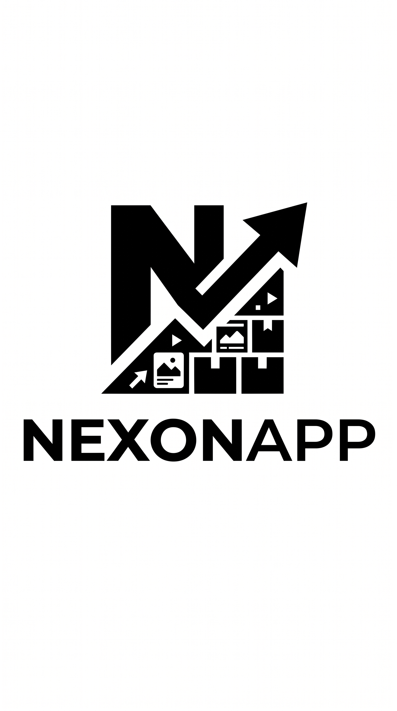

# Nexon App

[](https://flutter.dev/)
[](https://dart.dev/)
[](LICENSE)

---

## Screenshots

| Splash Screen | Home Page | [Fitur Lain] |
| :---: | :---: | :---: |
|  |  |  |

---

## Fitur Utama

- Responsive UI: Tampilan antarmuka yang bersih dan disesuaikan untuk berbagai ukuran layar.
- Fast & Smooth Navigation: Transisi halaman yang cepat menggunakan bawaan Flutter Navigator.
- Custom Assets & Splash: Tampilan splash screen khusus dengan penataan aset gambar internal.
- Clean Code Structure: Pemisahan file modular (`lib/home.dart`, `lib/splashscreen.dart`, `lib/main.dart`).

---

## Teknologi & Tools

* **Framework:** [Flutter](https://flutter.dev/)
* **Language:** [Dart](https://dart.dev/)
* **IDE:** VS Code / Android Studio
* **Distributed Version Control System** : Git


---

## Struktur Folder

```text
lib/
├── main.dart            # Entry point aplikasi
├── splashscreen.dart    # Tampilan awal (Splash Screen)
└── home.dart            # Halaman utama aplikasi
assets/
└── ss.jpg               # Tangkapan layar & aset gambar